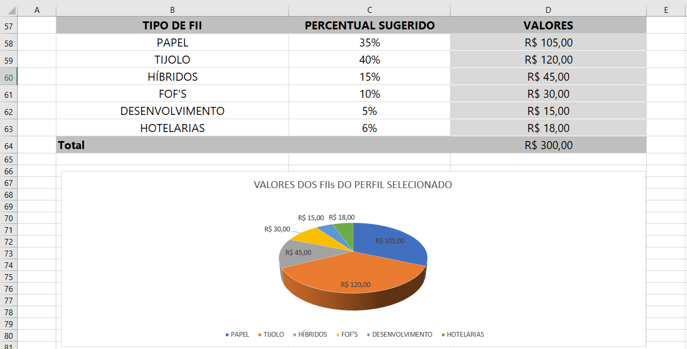

# Simulador de Investimentos em Fundos Imobiliários 

Desafio Criando uma Ferramenta de Controle de Investimentos com Excel do bootcamp **"Reclame AQUI - Dados e IA na Prática"**, feito pela [Digital Innovation One ](https://www.dio.me/).


## Objetivo

Os **Fundos de Investimento Imobiliário (FIIs)** são uma alternativa bastante conhecida para quem deseja investir no mercado imobiliário por meio da bolsa de valores, sem precisar comprar um imóvel diretamente. Eles permitem investir em carteiras de imóveis, como galpões logísticos, shoppings e edifícios corporativos, ou em títulos relacionados ao setor imobiliário.

Além da possibilidade de valorização das cotas, muitos FIIs distribuem rendimentos periódicos aos investidores. No entanto, esses pagamentos não são garantidos, e tanto o valor das distribuições quanto o preço das cotas podem variar ao longo do tempo.

Para quem está começando, algumas dúvidas são inevitáveis: quanto investir por mês? Por quanto tempo manter os investimentos? Quanto patrimônio é possível acumular? E qual retorno é razoável esperar?

Responder a essas perguntas exige considerar fatores como o **aporte**,  **prazo do investimento**, a **reinversão dos rendimentos** e os **riscos envolvidos**. Com simulações e premissas realistas, é possível estimar diferentes cenários de acumulação de patrimônio, sem confundir projeções com garantias de rentabilidade.

Esta planilha Excel permite simular:

- O **patrimônio acumulado** ao final de um investimento mensal recorrente;
- Os **dividendos mensais** estimados a partir desse patrimônio;
- Diferentes **cenários de prazo** (Entre 2 a 30 anos);
- Uma **sugestão de alocação da carteira** entre tipos de FII, de acordo com o perfil de risco do investidor. Os perfis de investimento são  Conservador, Moderado ou Agressivo.

## A planilha

A planilha possui 3 blocos:

### 1. Configurações gerais
Parâmetros de referência para o planejamento financeiro:
- Salário do investidor.
- Porcentagem de rendimento médio da carteira.
- De forma automática, a planilha sugere investir 30% do salário.

### 2. Simulação de investimento mensal
A partir dos valores — **valor do aporte mensal**, **prazo em anos** e **taxa de rendimento mensal** é feito o seguinte cálcuo:
- O **patrimônio acumulado**, usando a função financeira `VF` , que projeta o total investido somado aos juros compostos ao longo do tempo;
- Os **dividendos mensais esperados**, aplicando o percentual de rendimento da carteira sobre o patrimônio acumulado.

Uma tabela de **cenários** replica esse mesmo cálculo para diferentes prazos (Entre 2 a 30 anos), permitindo comparar a evolução do patrimônio.

### 3. Perfil de investidor
Existem 3 perfis de investidor, que são conservador, moderado ou agressivo. Numa planilha em separado existe o percentual sugerido para cada papel de acordo com o perfil. A seleção do valor é feita utilizando a função `PROCV`.De acordo com o aporte mensal é calculado o valor.

## Funções utilizadas

### 1. VF (Valor Futuro)

A função **VF** pertence à categoria de funções financeiras do Excel. Ela é utilizada para **calcular o montante futuro de um investimento** com base em pagamentos periódicos e constantes, sujeitos a uma taxa de juros fixa.

#### Para que serve na prática
É ideal para planejamento financeiro de médio e longo prazo. Com ela, você pode prever o saldo de uma aplicação acumulada a partir de depósitos recorrentes e rendimentos compostos.

#### Exemplo de uso
Descobrir quanto você terá acumulado daqui a 5 anos se depositar R$ 300,00 todos os meses em um fundo de investimento que rende 0,8% ao mês.

#### Estrutura e Sintaxe
```excel
=VF(taxa; nper; pgto; [vp]; [tipo])
```

* **`taxa`**: A taxa de juros por período (ex: `0,8%` ao mês).
* **`nper`**: O número total de períodos/parcelas (ex: `60` para 5 anos expressos em meses).
* **`pgto`**: O valor depositado em cada período (ex: `-300`). *Nota: em finanças, saídas de caixa são inseridas como valores negativos.*
* **`[vp]`** *(opcional)*: O valor presente ou saldo inicial que já está aplicado.
* **`[tipo]`** *(opcional)*: Define quando ocorrem os pagamentos (`0` ou omitido para o final do período; `1` para o início do período).

---

### 2. PROCV (Procura Vertical)

A função **PROCV** (Procurar na Vertical) é uma das ferramentas de busca e referência mais fundamentais do Excel. Ela permite **localizar um valor na primeira coluna** de um intervalo/tabela e **retornar uma informação correspondente** situada na mesma linha, em outra coluna.

#### Para que serve na prática
É utilizada para cruzar informações entre tabelas e automatizar o preenchimento de planilhas, eliminando a busca manual. Funciona de forma análoga a procurar um nome numa lista telefônica para encontrar o número correspondente.

#### Exemplo de uso
Inserir o **Código do Produto** na célula A2 e fazer com que o Excel preencha automaticamente a **Descrição** e o **Preço** buscando em uma tabela de cadastro de estoque em outra aba.

### Estrutura e Sintaxe
```excel
=PROCV(valor_procurado; matriz_tabela; num_indice_coluna; [procurar_intervalo])
```

* **`valor_procurado`**: O dado de referência que você deseja buscar (ex: o código `"PROD-102"`).
* **`matriz_tabela`**: O intervalo completo onde a busca será realizada. **A primeira coluna desse intervalo obrigatoriamente deve conter o `valor_procurado`**.
* **`num_indice_coluna`**: O número da coluna no intervalo de onde o dado de resposta deve ser extraído (ex: `2` para a segunda coluna da seleção).
* **`[procurar_intervalo]`**: Define o tipo de correspondência:
  * `FALSO` ou `0`: Para buscar uma **correspondência exata** (recomendado na maioria dos casos).
  * `VERDADEIRO` ou `1`: Para buscar uma correspondência aproximada.

---

### Resumo Comparativo

| Função | Categoria | Objetivo Principal | Quando usar? |
| :--- | :--- | :--- | :--- |
| **VF** | Financeira | Calcular rendimento e saldo futuro | Para estimar o resultado de poupanças e investimentos. |
| **PROCV** | Busca e Referência | Relacionar e puxar dados entre tabelas | Para preencher informações automaticamente com base em um código/chave. |


